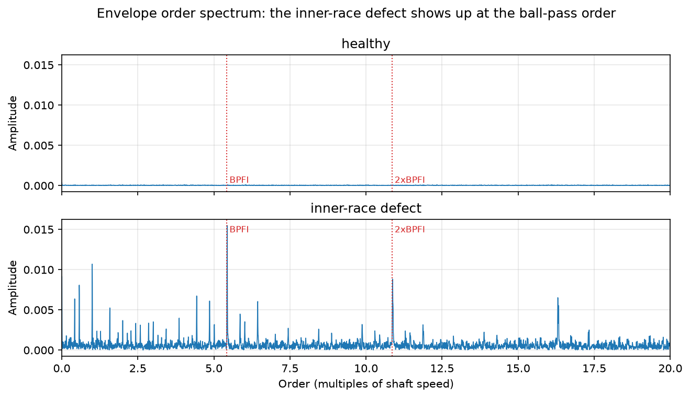
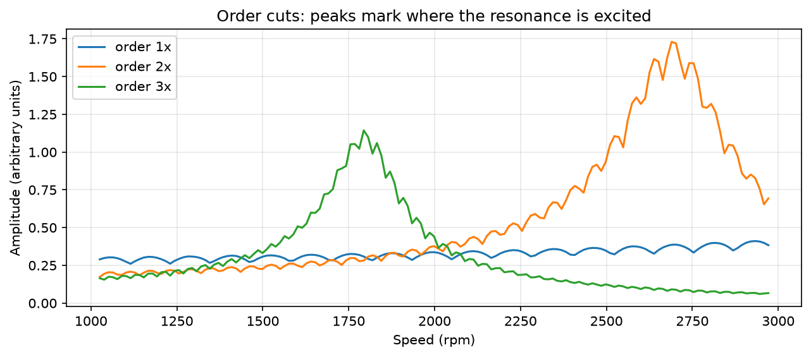

# From Music to Machine Vibration: a first look at NVH signal analysis

A short project that applies the same signal-processing tools to a **musical melody**, a **simulated run-up**, and **real bearing vibration measured on a test rig**, to show how Noise & Vibration (NVH) engineers find resonances and faults.

## Idea

A musical note is a vibration at a frequency; so is a rotating machine. The FFT, the spectrogram and the Hann window work the same way on both. I start with music, where I can hear whether the result is right, then move to a simulated run-up where I know the answer, and finally to real measured data.

## What the notebook does

1. **Melody to spectrum:** synthesize a short melody and read the notes back from FFT peaks (all within 2 cents).
2. **Windowing:** compare a rectangular and a Hann window. Leakage far from the peaks drops from about -88 dB to about -218 dB.
3. **Spectrogram:** see each note as a bright line with harmonics above it.
4. **Simulated run-up:** an engine accelerates from 1,000 to 3,000 rpm; orders 1x, 2x, 3x rise with speed and excite a 90 Hz resonance. Order cuts recover the planted resonance: 2x at about 2,690 rpm (planted 2,700) and 3x at about 1,794 rpm (planted 1,800). At 2,400 rpm the PSD peaks at 40, 80 and 120 Hz.
5. **Real machine data:** speed from a shaft encoder, vibration resampled to shaft angle, envelope **order spectrum** of a healthy bearing versus a bearing with an inner-race defect.

## Key results on real data

| Test | Strongest order | Amplitude |
|---|---|---|
| Healthy bearing | none above noise (6.04) | 0.00012 |
| Inner-race defect | **5.44** (expected inner-race order 5.43), harmonic at 10.87 | 0.0155 |

The defect appears at the same order even though the speed rises from about 790 to 1,525 rpm during the test, which is the point of order analysis. The peak is about 130 times the largest peak of the healthy bearing.




## Data

Real data: Huang, H. and Baddour, N., *Bearing Vibration Data under Time-varying Rotational Speed Conditions*, Mendeley Data, v2, DOI 10.17632/v43hmbwxpm.2, licence CC BY 4.0. Download `H-A-1.mat` (healthy, speed increasing) and `I-A-2.mat` (inner-race defect, speed increasing) into `data/`. Each file has `Channel_1` (accelerometer) and `Channel_2` (encoder, 1,024 pulses per revolution), sampled at 200 kHz for 10 s. The notebook still runs without them (sections 1 to 4 and 6 to 7); section 5 prints a message instead.

## Limitations

- Sections 3 and 4 use **simulated** data (single-degree-of-freedom resonance, 5% damping), so they validate the method only.
- The real data is a **bearing test rig**, not an engine or vehicle, and I analyzed only two files (healthy and inner race). The bearing geometry (9 balls, 7.94 mm ball, 38.52 mm pitch) is assumed from the ER-16K bearing; the data confirms it (peak at 5.44 versus 5.43 expected).
- It is a learning project, not a diagnosis tool.

## Run it

```
python -m venv .venv
.venv\Scripts\activate
pip install -r requirements.txt
jupyter notebook nvh_music_to_vibration.ipynb
```

Tools: Python, NumPy, SciPy, pandas, Matplotlib, Jupyter.
